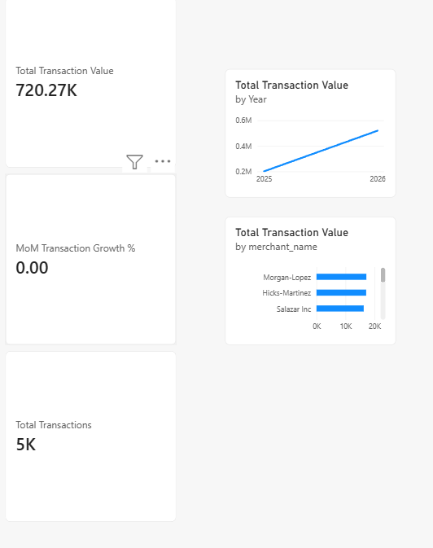
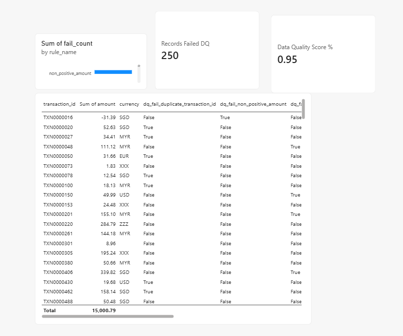
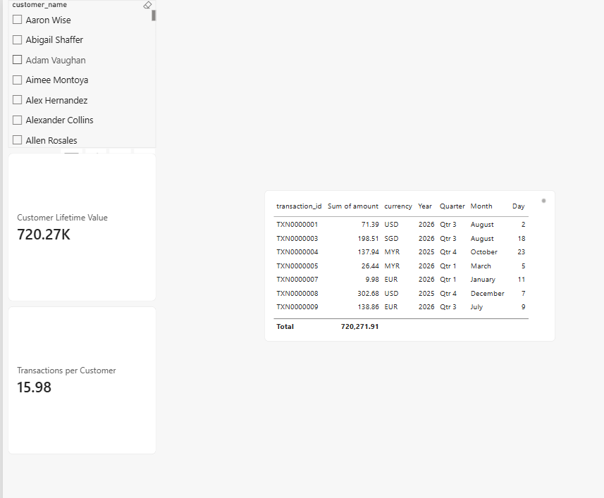
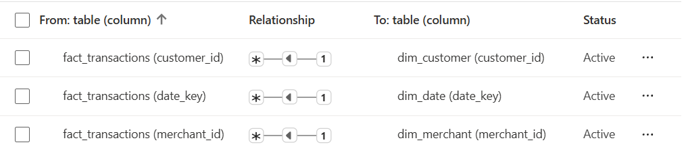

# Fintech Transaction Data Quality & KPI Dashboard

A small end-to-end data project: synthetic fintech transaction data →
Python ETL and rule-based data quality checks → star schema → Power BI
dashboard with a dedicated data quality page.

Built to extend real production experience validating fintech data at
Biztory Cloud Accounting (2025 internship) into a portfolio piece that
shows the full pipeline, not just the dashboard.

## Why this project

Dashboards are only as trustworthy as the data behind them. This project
treats data quality as a first-class part of the pipeline — every record
that fails a validation rule is tracked, categorised, and surfaced on its
own dashboard page, rather than being silently dropped.

## Architecture

```
Synthetic data generator (Faker)
        │
        ▼
Raw CSVs (data/raw/)
        │
        ▼
Data quality checks (etl/data_quality_checks.py)
   — 6 rule-based checks, per-rule fail counts, overall DQ score
        │
        ▼
Cleaning + star schema build (etl/clean_transactions.py)
   — fact_transactions, dim_date, dim_customer, dim_merchant
        │
        ▼
Power BI (powerbi/fintech_dashboard.pbix)
   — Overview / Data Quality / Drill-through pages
```

## Setup

```bash
pip install -r requirements.txt

cd etl
python generate_synthetic_data.py --rows 5000 --dirty-rate 0.05
python data_quality_checks.py
python clean_transactions.py
```

This produces the following in `data/processed/`, ready to import into
Power BI (Get Data > Text/CSV):

| File | Description |
|---|---|
| `fact_transactions.csv` | clean transactions that passed all DQ rules |
| `dim_date.csv` | date dimension |
| `dim_customer.csv` | customer dimension |
| `dim_merchant.csv` | merchant dimension |
| `dq_rule_summary.csv` | one row per DQ rule with fail counts |
| `transactions_rejected.csv` | transactions that failed at least one rule |

## Data quality rules

| Rule | Checks for |
|---|---|
| `missing_customer_id` | null customer reference |
| `missing_amount` | null transaction amount |
| `non_positive_amount` | zero or negative amount |
| `invalid_currency` | currency code outside allowed list (MYR, USD, SGD, EUR) |
| `future_dated_transaction` | transaction date after today |
| `duplicate_transaction_id` | repeated transaction ID |

## Power BI model

Star schema (see `sql/schema.sql`):

```
        dim_date
           │
dim_customer ─ fact_transactions ─ dim_merchant
```

DAX measures are documented in `powerbi/dax_measures.md` — copy them
directly into Power BI's Measures table after importing the CSVs.

## Dashboard pages

1. **Overview** — transaction volume/value trends, MoM growth, top merchants


2. **Data Quality** — DQ score KPI, fail count by rule, rejected records table


3. **Drill-through** — per-customer / per-merchant transaction detail


### Data Model


## Tech stack

Python (Pandas, NumPy, Faker) · SQL · Power BI · DAX